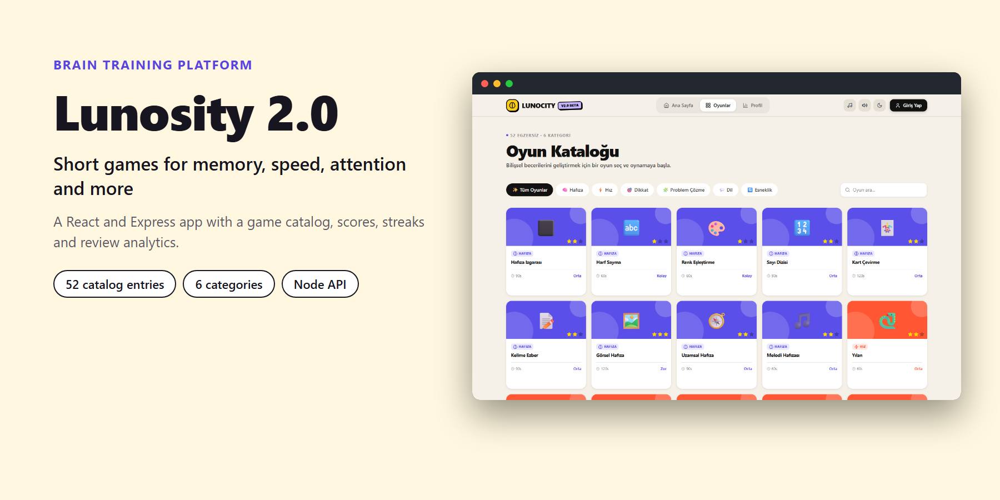
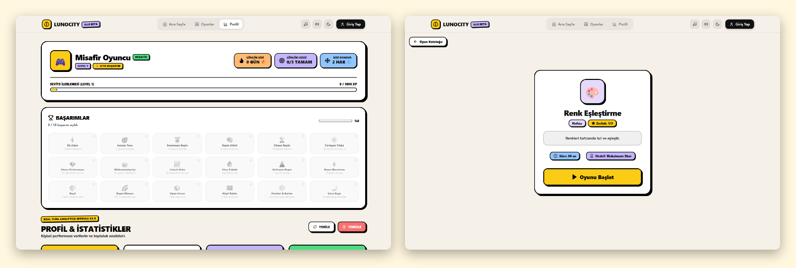

<p align="center">
  <a href="#demo">Demo</a> ·
  <a href="#what-it-does">What it does</a> ·
  <a href="#how-it-works">How it works</a> ·
  <a href="#run-it">Run it</a> ·
  <a href="#known-limits">Known limits</a> ·
  <a href="#türkçe">Türkçe</a>
</p>

**Lunosity 2.0** is a brain-training web app. Pick a short game, play against the clock, and follow your scores, streak and achievements on your profile. The interface is in Turkish.

> [!NOTE]
> This is an independent student project inspired by Lumosity. It is not affiliated with Lumosity.

**Built with:** React 18 · Vite · Tailwind CSS · Node.js · Express.

## Demo

<p align="center"><a href="https://youtu.be/GkTWH3RuD7Y"></a></p>

<p align="center"><sub><b>Fig. 1</b> · The promo video on <a href="https://youtu.be/GkTWH3RuD7Y">YouTube</a>.</sub></p>

<p align="center"></p>

<p align="center"><sub><b>Fig. 2</b> · The profile and a game start card, captured from a local build in a new guest session, so the numbers are still zero.</sub></p>

## What it does

<table>
  <tr><td><b>Game catalog</b></td><td>52 entries in 6 categories, with search and category filters.</td></tr>
  <tr><td><b>Profile</b></td><td>Level and XP, daily goal, streak, streak freezes and 18 achievements.</td></tr>
  <tr><td><b>Scores</b></td><td>Score history, per-game leaderboards and user statistics through the API.</td></tr>
  <tr><td><b>Review analytics</b></td><td>Community statistics, sentiment and score comparison from a public file of Lumosity reviews.</td></tr>
  <tr><td><b>Look and sound</b></td><td>Light and dark themes, music and sound effects.</td></tr>
</table>

| Category | Entries |
|---|:---:|
| Memory | 9 |
| Speed | 8 |
| Attention | 6 |
| Problem solving | 9 |
| Language | 10 |
| Flexibility | 10 |

## How it works

The React app is in `frontend/`. In development, Vite forwards `/api` to the Express server in `backend/`. The server parses the review file at startup and keeps results in memory. Scores are stored in `backend/db/scores.json`.

| Endpoint | Purpose |
|---|---|
| `GET /api/games` | Game list |
| `GET /api/feedback/stats` | Community statistics |
| `GET /api/feedback/sentiment` | Sentiment breakdown |
| `GET /api/feedback/compare?score=85&gameId=fast-math` | Compare a score |
| `GET /api/feedback/recent?limit=20` | Recent reviews |
| `POST /api/scores` | Save a score |
| `GET /api/scores/user/:userId` | User history |
| `GET /api/scores/leaderboard/:gameId` | Leaderboard |
| `GET /api/scores/stats/:userId` | User statistics |

## Run it

```bash
git clone https://github.com/huseyinbaranisik/Lunosity.git
cd Lunosity/backend
npm install
npm run download-data
npm run dev
```

The API runs at `http://localhost:5000`. In a second terminal:

```bash
cd Lunosity/frontend
npm install
npm run dev
```

The app opens at `http://localhost:5173`.

## Known limits

- Sign-in is local to the browser. There is no real account system or password check.
- Review analytics need the roughly 10 MB data file, which is downloaded separately.
- The app starts without the data file, but review statistics stay empty.

---

## Türkçe

**Lunosity 2.0**, beyin antrenmanı için bir web uygulaması. Kısa bir oyun seç, süreye karşı oyna; skorlarını, serini ve başarımlarını profilinden takip et.

> [!NOTE]
> Bu proje Lumosity'den esinlenen bağımsız bir öğrenci projesidir, Lumosity ile bağlantısı yoktur.

**Teknoloji:** React 18 · Vite · Tailwind CSS · Node.js · Express.

### Demo

Şekil 1 [YouTube'daki tanıtım videosu](https://youtu.be/GkTWH3RuD7Y). Şekil 2'de yerel derlemeden, yeni bir misafir oturumunda alınan profil ve oyun başlangıç ekranı var, bu yüzden sayılar sıfır.

### Neler yapıyor

- **Oyun kataloğu:** 6 kategoride 52 kayıt, arama ve kategori filtresi.
- **Profil:** Seviye ve XP, günlük hedef, seri, seri dondurma ve 18 başarım.
- **Skorlar:** API üzerinden skor geçmişi, oyun bazlı liderlik tablosu ve kullanıcı istatistikleri.
- **Yorum analizi:** Herkese açık bir Lumosity yorum dosyasından topluluk istatistiği, duygu analizi ve skor karşılaştırması.
- **Görünüm ve ses:** Aydınlık ve karanlık tema, müzik ve ses efektleri.

### Nasıl çalışıyor

React uygulaması `frontend/`, Express sunucusu `backend/` klasöründe. Geliştirmede Vite, `/api` isteklerini sunucuya yönlendirir. Sunucu yorum dosyasını açılışta işler ve sonuçları bellekte tutar. Skorlar `backend/db/scores.json` dosyasına yazılır.

### Çalıştır

```bash
git clone https://github.com/huseyinbaranisik/Lunosity.git
cd Lunosity/backend
npm install
npm run download-data
npm run dev
```

API `http://localhost:5000` adresinde çalışır. İkinci bir terminalde:

```bash
cd Lunosity/frontend
npm install
npm run dev
```

Uygulama `http://localhost:5173` adresinde açılır.

### Bilinen sınırlar

- Giriş yalnızca tarayıcıda tutulur, gerçek hesap sistemi ya da şifre kontrolü yoktur.
- Yorum analizi, ayrıca indirilen yaklaşık 10 MB'lık veri dosyasına ihtiyaç duyar.
- Uygulama veri dosyası olmadan da açılır, ama yorum istatistikleri boş kalır.
